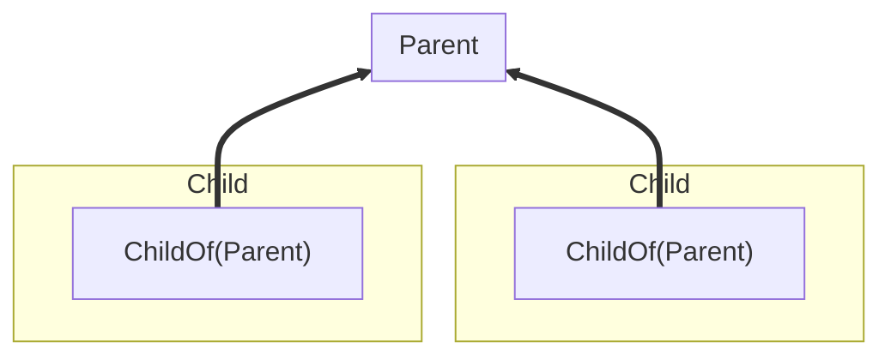
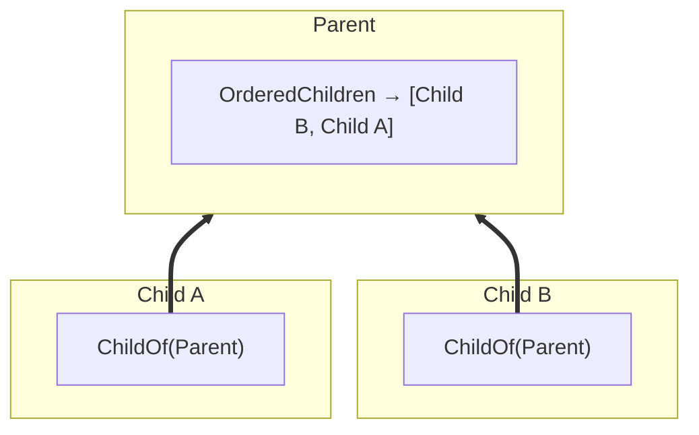

Koota supports relations between entities using the `relation` function. Relations allow you to build graphs by creating connections between entities with efficient queries.

## Relations basics

```js
const ChildOf = relation()

const parent = world.spawn()
const child = world.spawn(ChildOf(parent))

const entity = world.queryFirst(ChildOf(parent)) // Returns child
```

A relation is typically owned by the entity that needs to express it. The **source** is the entity that has the relation added, and the **target** is the entity it points to.



In `child.add(ChildOf(parent))`, child is the source and parent is the target. This design means the parent doesn't need to know about its children, instead children care about their parent, optimizing batch queries.

## Relations with data

Relations can contain data like any trait.

```js
const Contains = relation({ store: { amount: 0 } })

const inventory = world.spawn()
const gold = world.spawn()

// Pass initial data when adding
inventory.add(Contains(gold, { amount: 10 }))

// Update data with set
inventory.set(Contains(gold), { amount: 20 })

// Read data with get
const data = inventory.get(Contains(gold)) // { amount: 20 }
```

The values passed with a pair are typed by the store. A store field can be [required](trait.md#required-fields), and the pair must then carry it when it is added. Reads and queries still name the pair without values.

```ts
const Holds = relation({ store: { item: required<Item>(), count: 1 } })

holder.add(Holds(target, { item })) // count defaults to 1
holder.has(Holds(target)) // true

// ❌ Type error
holder.add(Holds(target))
```

A relation without a store has no record, so `get` returns `undefined` for its pairs. Check for a pair with `has`.

## Auto destroy

Relations can automatically destroy related entities when their counterpart is destroyed using the `autoDestroy` option.

### Destroy orphans

When a target is destroyed, destroy all sources pointing to it. This is commonly used for hierarchies when you want to clean up any detached graphs. It can be enabled with the `'orphan'` or `'source'` option.

```js
const ChildOf = relation({ autoDestroy: 'orphan' }) // Or 'source'

const parent = world.spawn()
const child = world.spawn(ChildOf(parent))
const grandchild = world.spawn(ChildOf(child))

parent.destroy()

world.has(child) // False, the child and grandchild are destroyed too
```

### Destroy targets

When a source is destroyed, destroy all its targets.

```js
const Contains = relation({ autoDestroy: 'target' })

const container = world.spawn()
const itemA = world.spawn()
const itemB = world.spawn()

container.add(Contains(itemA), Contains(itemB))
container.destroy()

world.has(itemA) // False, items are destroyed with container
```

Retained relation pairs still match `Removed` query filters until eviction. Ordinary entity methods require a live entity. See [Destroyed entities](query-modifiers.md#destroyed-entities).

## Exclusive relations

Exclusive relations ensure each entity can only have one target.

```js
const Targeting = relation({ exclusive: true })

const hero = world.spawn()
const rat = world.spawn()
const goblin = world.spawn()

hero.add(Targeting(rat))
hero.add(Targeting(goblin))

hero.has(Targeting(rat)) // False
hero.has(Targeting(goblin)) // True
```

## Ordered relations

Ordered relations keep related entities in an explicit order. Add the ordered trait to the target entity.



```js
import { ordered, relation, trait } from 'koota'

const Position = trait({ x: 0 })
const ChildOf = relation()
const OrderedChildren = ordered(ChildOf)

const parent = world.spawn(OrderedChildren)
const childA = world.spawn(Position)
const childB = world.spawn(Position)
const children = parent.get(OrderedChildren)

children.add(childA) // Adds ChildOf(parent)
childB.add(ChildOf(parent)) // Appends childB
children.moveTo(childB, 0) // Order: childB, childA
```

The view and relation stay in sync. Adding the same child twice has no effect. Edits notify the parent's ordered trait.

Iterate and update traits in child order. Each child must have the traits passed to `select`.

```js
children.at(0) // childB
const ids = children.map((child) => child.id())

children.select(Position).each((position, child, index) => {
  position.x = index * 100
})
```

Edit membership and order through the view:

```js
children.insert(childA, 0) // Moves an existing child to index 0
children.sort((a, b) => a.get(Position).x - b.get(Position).x)
children.reverse()
children.remove(childA) // Removes ChildOf(parent)
children.clear() // Removes all ChildOf(parent) pairs
```

Adding the ordered trait collects existing children. Removing it leaves their relations intact. Each walk keeps the sequence it started with.

Ordering work happens when children are added, removed, or reordered. For order derived from trait values, use a [sorted query](query.md#ordered-views).

## Querying relations

Relations can be queried with specific targets and wildcard targets using `*`.

```js
const gold = world.spawn()
const silver = world.spawn()
const inventory = world.spawn(Contains(gold), Contains(silver))

const targets = inventory.targetsFor(Contains) // Returns [gold, silver]

const chest = world.spawn(Contains(gold))

const containsSilver = world.query(Contains(silver)) // Returns [inventory]
const containsAnything = world.query(Contains('*')) // Returns [inventory, chest]
```

## Relation filters

A query nested in a relation can be used to filter target entities instead of naming one specific target. Use them when you want to ask for relations pointing at "any player", "any active parent", or "any rare item".

```js
const IsRare = trait()

silver.add(IsRare)

const containsRareItems = world.query(Contains(IsRare))
const equippedOnAngryGoblin = world.query(EquippedOn(Goblin, IsAngry))
```

## Removing relations

A relation targets a specific entity, so we need to likewise remove relations with specific entities.

```js
// Add a specific relation
player.add(Likes(apple))
player.add(Likes(banana))

// Remove that same relation
player.remove(Likes(apple))

player.has(apple) // false
player.has(banana) // true
```

However, a wildcard can be used to remove all relations of a kind — for all targets — from an entity.

```js
player.add(Likes(apple))
player.add(Likes(banana))

// Remove all Likes relations
player.remove(Likes('*'))

player.has(apple) // false
player.has(banana) // false
```

## Tracking relation changes

Relations work with tracking modifiers to detect when entities gain, lose, or update relations. Use a relation store to track data writes.

```js
import { createAdded, createRemoved, createChanged } from 'koota'

const Added = createAdded()
const Removed = createRemoved()
const Changed = createChanged()

const ChildOf = relation({ store: { priority: 0 } })

// Track when any entity adds the ChildOf relation
const newChildren = world.query(Added(ChildOf))

// Track when any entity removes the ChildOf relation
const orphaned = world.query(Removed(ChildOf))

// Track relation additions and data writes
const updated = world.query(Changed(ChildOf))
```

Pass a pair to track one target. `Added(ChildOf(parent))` reports the entities that gained that pair and `Removed(ChildOf(parent))` those that lost it, including when the entity or the target is destroyed. `Changed(ChildOf(parent))` reports the entities whose pair was added or had its store data written.

```js
const parent = world.spawn()

// Track one pair
const newChildren = world.query(Added(ChildOf(parent)))
const lostChildren = world.query(Removed(ChildOf(parent)))
const updatedChildren = world.query(Changed(ChildOf(parent)))

// Track pairs with a relation filter
const newPlayerChildren = world.query(Added(ChildOf(IsPlayer, IsActive)))
```

> [!IMPORTANT]  
> `Changed(ChildOf), ChildOf(parent)` is a different query. It tracks a change to any `ChildOf` pair of an entity and then filters by the entities that have `parent` as a target.

## Relation events

Relations emit events per **pair**. This makes it easy to know exactly which target was involved.

- `onAdd(Relation, (entity, target) => {})` triggers when `entity.add(Relation(target))` is called.
- `onRemove(Relation, (entity, target) => {})` triggers when `entity.remove(Relation(target))` is called.
- `onChange(Relation, (entity, target) => {})` triggers when a pair is added or its store data is written. Pair additions also fire for relations without a store.

```js
const ChildOf = relation({ store: { priority: 0 } })

const unsubAdd = world.onAdd(ChildOf, (entity, target) => {})
const unsubRemove = world.onRemove(ChildOf, (entity, target) => {})
const unsubChange = world.onChange(ChildOf, (entity, target) => {})

const parent = world.spawn()
const child = world.spawn()

child.add(ChildOf(parent)) // onAdd(child, parent), onChange(child, parent)
child.set(ChildOf(parent), { priority: 1 }) // onChange(child, parent)
child.remove(ChildOf(parent)) // onRemove(child, parent)
```

Hooks also accept **relation pairs** for target-specific filtering. `ChildOf(parent)` only fires for that specific target, while `ChildOf('*')` fires for any target (equivalent to passing the relation itself).

```js
// Only fires when a ChildOf relation to this specific parent is added
world.onAdd(ChildOf(parent), (entity, target) => {})

// Fires for any ChildOf addition, the same as passing the ChildOf trait
world.onAdd(ChildOf('*'), (entity, target) => {})
```
