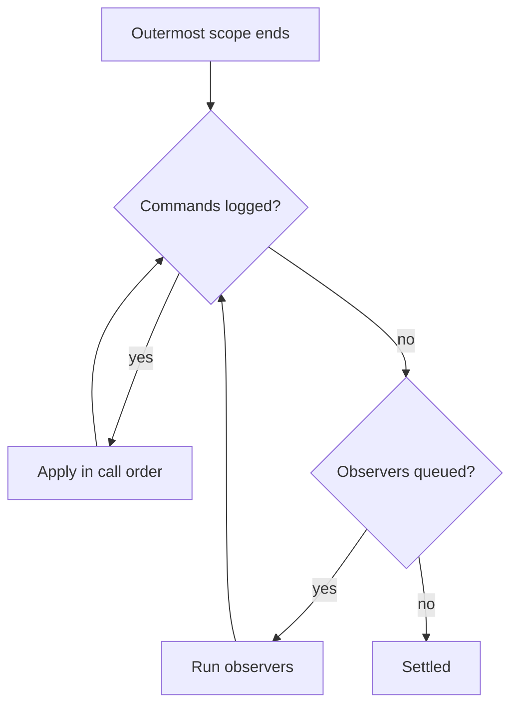

# Deferred Structural Changes

Structural changes made inside a defer scope are logged as commands and applied when the outermost scope ends. A walk never loses a row or the data under it, and a hook never changes the operation it is reporting.

```ts
world.query(Position).each((position, entity) => {
  entity.remove(Position) // logged
  entity.has(Position) // true
})
// applied here
```

## Scopes

The world holds one counter, `deferDepth`. A scope is open while it is nonzero, and scopes nest by counting.

- Every structural operation opens a scope around its work and its hooks.
- Callback walks (`each`, `forEach`, `readEach`, `updateEach`) open one around their callbacks.
- `world.defer(fn)` opens one around a function.

A `for...of` loop opens no scope. Its changes apply at once and the loop keeps the sequence it started with. Wrap it in `world.defer` to defer them.

## Commands

Inside a scope `add`, `remove`, `upsert`, `destroy`, machine transitions and ordered view edits append to `ctx.commands` instead of running. `spawn`, `set` and `changed` are never deferred.

The world reads as it did when the scope opened, plus data writes and spawned entities. `has`, `isAlive` and nested queries still report a pending removal or destroy.

## Flow



Commands logged by hooks while the log applies form the next wave. Observers run once the log is empty, and their changes start the next round.

## Important details

- A command whose entity died earlier in the log is dropped.
- A command holds its arguments by reference. A value passed to `add` is read when the command applies.
- `set` on a trait whose `add` is still pending throws with assertions on. Pass the value through `add` or use `upsert`.
- An error thrown by a command or observer lets the drain finish, then the first error is rethrown.
- The drain throws after 100000 waves or 100 observer rounds. Changes already applied stay committed.
- `world.reset` and `world.destroy` throw inside a scope.
- Scopes belong to one world. A hook can change another world immediately unless that world has its own scope open.
