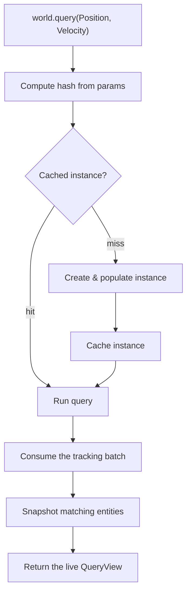

# Query

## Query Resolution

How `world.query(...)` resolves inline trait refs into a result.

### Trait ref params

This is the most common path. The user passes trait refs directly as arguments.

```
world.query(Position, Velocity)
```

### Flow



### Steps

**1. Query**

```ts
world.query(Position, Velocity)
```

Trait refs are passed as arguments to `world.query`. Each ref carries a stable numeric ID used for hashing.

**2. Compute hash**

```ts
const hash = createQueryHash(params)
```

Trait IDs are sorted and joined into a canonical string key. Parameter order doesn't matter — `query(A, B)` and `query(B, A)` produce the same hash.

**3. Get cached instance**

```ts
let query = ctx.queriesHashMap.get(hash)

if (!query) {
  query = createQueryInstance(ctx, params)
  ctx.queriesHashMap.set(hash, query)
}
```

The hash looks up an existing `QueryInstance`. On a miss a new instance is created: it processes the parameters, builds bitmasks, and populates matching entities via bitmask checks against all live entities. The instance is then cached for future calls.

**4. Run**

```ts
query.run(ctx, params)
```

Snapshots the instance's entity set. For tracking queries (e.g. `Added`, `Removed`, `Changed`) the set is cleared and bitmasks reset so changes can accumulate again before the next call.

**5. Return result**

```ts
return bindQueryView(ctx, query, params)
```

The caller receives a `QueryView`, a live view over the instance's entity set with methods for iterating with trait data. The view is cached per ordered trait and target projection, so a run allocates nothing.

## Target projection

Matching and projection are separate. A binding keeps trait stores for record access and one ordered projection list containing data traits and relation storage instances. That list supplies callback order, binding comparison and iterator cache keys. Every required pair projects one argument. Projections are interned per relation instance and mode. Slot passes what the relation stores for the entity. That is the single target an exclusive relation holds, for wildcards and target queries alike, and the live target list of a non-exclusive wildcard. Constant passes a concrete pair's own target, read from the binding so shared iterators stay correct. Filter snapshots the targets inside the match set the query resolved for a non-exclusive target query, falling back to slot when the walked view has no such filter, as with a selection outside the query. Pairs inside modifiers remain filters.

The generated positional iterator hoists the target storage references outside the entity loop and reads each selected slot into a callback argument. A non-exclusive slot is the entity's own target list and is passed without a copy. Only a filtered projection copies, into a reusable array. When trait cursors already track page changes, target pages share that page switch. The relation policy is resolved at compilation, without a per-entity policy branch or target lookup call. Unselected targets generate no reads or copies. Trait-only iterators keep their existing loop bodies.

`targetsFor` retains its snapshot behavior. Arrays passed to `each` are read only. A wildcard projection passes the relation's own list, which the walk's defer scope keeps unchanged until the outermost walk ends. A filtered projection passes a snapshot from the iteration-buffer pool, which owns one array per filtered projection and active walk and reuses it for later rows and calls. Legacy state-array iterators and page stores continue to expose trait data only.

The walk visits the membership captured when it started. Structural changes made by callbacks apply when the outermost walk ends, so later rows keep their traits and relation targets. See [defer.md](./defer.md).

### Validation and performance

`query-relation-targets.test.ts` covers callback order and tracking, target stability through structural commands and nested walks, selection,
query references, excluded pairs, legacy layouts, derived views, world isolation and widened types.
Explicit-schema inference is checked alongside the exclusive and non-exclusive behavior tests.

`query-relation-inline.bench.ts` keeps ten cases. One exclusive relation measures unused,
selected and consumed targets. Non-exclusive relations measure consumed and unused target lists, including 32 targets to show the cost does not grow with the list.
Three relations cover unused argument scaling and consuming multiple arrays on scattered pages.
A plain-trait control checks unrelated iteration, and a concrete lookup with target selection
checks iterator reuse for views outside cached queries. Existing `query-api` benchmarks cover
warm inline lookup costs, including target-query filters.

The fixture generates literal relation arguments and detects the callback shape through a separate
binding before timing. Timed runs perform `world.query(...).each(...)`. Results are checked against
independent expected values outside timing. Arrays passed to callbacks are consumed directly.

```sh
pnpm bench --against ../koota-relation-each-canary '@relation-each-inline' --blocks 6 -n relation-each-snapshots
```

Compare the relation each benches against the merge base before and after changes to the generated loop. Consumed target lists should stay well ahead of the per entity `targetsFor` allocation they replace, unused lists should cost the same as an exclusive target whatever the target count, and the selection and plain trait controls should show no change.

### Inlining

Measured bytecode on Node 24.14.0, using the emitted bundle and generated iterators:

| Function or iterator                        | Bytes |
| ------------------------------------------- | ----- |
| Plain trait or targets excluded with select | 130   |
| One trait and one exclusive target          | 156   |
| One trait and one target array              | 156   |
| One trait and three target arrays           | 220   |
| Three target arrays without trait records   | 162   |
| One trait and one filtered target array     | 201   |
| Tracked trait and three target arrays       | 303   |
| Buffer preparation                          | 297   |
| Filtered target snapshot copy               | 77    |

These paths fit the 460-byte per-function budget. V8's `--trace-turbo-inlining` confirmed that
the filtered snapshot helper and small callbacks inline into the generated loops. Exclusive targets
and target lists share the direct slot read. Trait-only and selected iteration bytecode is unchanged.

## Important details

- Query instances are cached two ways: by canonical hash in `ctx.queriesHashMap`, and for pre-built query refs by numeric `queryRef.id` in `ctx.queryInstances`. The second path avoids recomputing the same hash lookup for shared query refs.
- Query matching is incremental after creation. Structural changes do not rebuild every query from scratch; they update only the queries affected by the touched trait or relation.

## Fast paths

- A shared query ref created ahead of time can resolve directly through `queryRef.id`.
- A single relation pair with a specific target can skip the general query pipeline and use the relation reverse lookup path directly.

## Tracking queries

Tracking modifiers such as `Added`, `Removed`, and `Changed` build on the same query cache, but they also maintain paged tracking masks and snapshots.

- They use paged tracking masks and snapshots.
- After `query.run(...)`, they clear transient results and reset tracking state.

## Relation filters

Base trait/relation matching is bitmask-driven, but relation pairs are not fully representable in the entity mask, so target-specific filtering is applied as an extra step.
