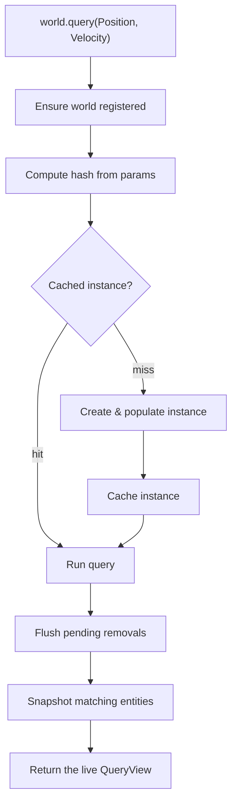

# Query

## Query Resolution

How `world.query(...)` resolves inline trait refs into a result.

### Trait ref params

This is the most common path. The user passes trait refs directly as arguments.

```
world.query(Position, Velocity)
```

### Flow



### Steps

**1. Query**

```ts
world.query(Position, Velocity)
```

Trait refs are passed as arguments to `world.query`. Each ref carries a stable numeric ID used for hashing.

**2. Ensure world registered**

```ts
const ctx = world[$internal]
ensureWorldRegistered(ctx, world, id)
```

Querying is also a registration point. If the world has not been used yet, this step registers it, initializes tracking masks, and creates the world entity.

**3. Compute hash**

```ts
const hash = createQueryHash(params)
```

Trait IDs are sorted and joined into a canonical string key. Parameter order doesn't matter — `query(A, B)` and `query(B, A)` produce the same hash.

**4. Get cached instance**

```ts
let query = ctx.queriesHashMap.get(hash)

if (!query) {
  query = createQueryInstance(ctx, params)
  ctx.queriesHashMap.set(hash, query)
}
```

The hash looks up an existing `QueryInstance`. On a miss a new instance is created: it processes the parameters, builds bitmasks, and populates matching entities via bitmask checks against all live entities. The instance is then cached for future calls.

**5. Run**

```ts
query.run(ctx, params)
```

Flushes any deferred removals, then snapshots the instance's entity set. For tracking queries (e.g. `Added`, `Removed`, `Changed`) the set is cleared and bitmasks reset so changes can accumulate again before the next call.

**6. Return result**

```ts
return bindQueryView(ctx, query, params)
```

The caller receives a `QueryView`, a live view over the instance's entity set with methods for iterating with trait data. The view is cached per ordered trait and target projection, so a run allocates nothing.

## Target projection

Matching and projection are separate. A binding keeps trait stores for record access and one ordered projection list containing data traits and relation storage instances. That list supplies callback order, binding comparison and iterator cache keys. Every required pair projects one argument. Projections are interned per relation instance and mode. Slot reads the single target an exclusive relation holds, for wildcards and target queries alike. Copy snapshots a non-exclusive wildcard's target array. Constant passes a concrete pair's own target, read from the binding so shared iterators stay correct. Filter snapshots the targets inside the match set the query resolved for a non-exclusive target query, falling back to copy when the walked view has no such filter, as with a selection outside the query. Pairs inside modifiers remain filters.

The generated positional iterator hoists the target storage references outside the entity loop and reads each selected slot into a callback argument. Non-exclusive slots are copied into reusable arrays before the callback. When trait cursors already track page changes, target pages share that page switch. The relation policy is resolved at compilation, without a per-entity policy branch or target lookup call. Unselected targets generate no reads or copies. Trait-only iterators keep their existing loop bodies.

`targetsFor` retains its snapshot behavior. Arrays passed to `each` are reusable read-only snapshots. The iteration-buffer pool owns one array per non-exclusive projection and active walk, so structural commands and nested walks cannot alter the current callback's snapshot. Arrays are reused for later rows and calls. Legacy state-array iterators and page stores continue to expose trait data only.

The walk visits the membership captured when it started. Removals are deferred while a query is iterating, so a row whose entity left the query, through a relation or trait removal or destroy in an earlier callback, is skipped instead of reading storage the removal already cleared. The entity index revision moves on every handle release and every deferred removal, so the generated loop compares it once per row and only calls the skip helper after it has changed during the walk. A walk whose callbacks remove rows from the query pays one skip check for every later row, a few nanoseconds each. Sorted and owned views walk a copy, so their removals apply at once, and the skip helper also drops rows no longer in the query's exposed set. Tracking walks consume a batch that removals never touch, so they only skip destroyed rows. This gate is an interim measure. Deferring structural changes until the outermost walk ends, as Flecs does, is the planned replacement.

### Validation and performance

`query-relation-targets.test.ts` covers callback order and tracking, snapshot stability, buffer reuse, selection,
query references, excluded pairs, legacy layouts, derived views, world isolation and widened types.
Explicit-schema inference is checked alongside the exclusive and non-exclusive behavior tests.

`query-relation-inline.bench.ts` keeps ten cases. One exclusive relation measures unused,
selected and consumed targets. Non-exclusive relations measure consumed and unused snapshots, including 32 targets to expose copy cost.
Three relations cover unused argument scaling and consuming multiple arrays on scattered pages.
A plain-trait control checks unrelated iteration, and a concrete lookup with target selection
checks iterator reuse for views outside cached queries. Existing `query-api` benchmarks cover
warm inline lookup costs, including target-query filters.

The fixture generates literal relation arguments and detects the callback shape through a separate
binding before timing. Timed runs perform `world.query(...).each(...)`. Results are checked against
independent expected values outside timing. Arrays passed to callbacks are consumed directly.

```sh
pnpm bench --against ../koota-relation-each-canary '@relation-each-inline' --blocks 6 -n relation-each-snapshots
```

Compare the relation each benches against the merge base before and after changes to the generated loop. Consumed snapshots should stay well ahead of the per entity `targetsFor` allocation they replace, unused snapshots should cost a few nanoseconds per entity that grow with the target count, and the selection and plain trait controls should show no change.

### Inlining

Measured bytecode on Node 24.14.0, using the emitted bundle and generated iterators:

| Function or iterator                        | Bytes |
| ------------------------------------------- | ----- |
| Plain trait or targets excluded with select | 189   |
| One trait and one exclusive target          | 216   |
| One trait and one target array              | 241   |
| One trait and three target arrays           | 357   |
| Three target arrays without trait records   | 270   |
| One trait and one constant target           | 208   |
| One trait and one filtered target array     | 271   |
| Tracked trait and three target arrays       | 443   |
| Buffer preparation                          | 416   |
| Target snapshot copy                        | 55    |
| Filtered target snapshot copy               | 77    |

These paths fit the 460-byte per-function budget. V8's `--trace-turbo-inlining` confirmed that
the snapshot copy helpers and small callbacks inline into the generated loops. Exclusive targets
keep their direct slot reads. Trait-only and selected iteration bytecode is unchanged.

## Important details

- Query instances are cached two ways: by canonical hash in `ctx.queriesHashMap`, and for pre-built query refs by numeric `queryRef.id` in `ctx.queryInstances`. The second path avoids recomputing the same hash lookup for shared query refs.
- Query matching is incremental after creation. Structural changes do not rebuild every query from scratch; they update only the queries affected by the touched trait or relation.

## Fast paths

- A shared query ref created ahead of time can resolve directly through `queryRef.id`.
- A single relation pair with a specific target can skip the general query pipeline and use the relation reverse lookup path directly.

## Tracking queries

Tracking modifiers such as `Added`, `Removed`, and `Changed` build on the same query cache, but they also maintain paged tracking masks and snapshots.

- They use paged tracking masks and snapshots.
- After `query.run(...)`, they clear transient results and reset tracking state.

## Relation filters

Base trait/relation matching is bitmask-driven, but relation pairs are not fully representable in the entity mask, so target-specific filtering is applied as an extra step.
